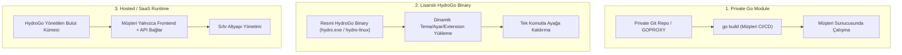
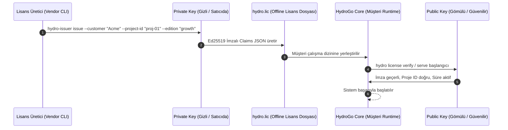

# HydroGo Commercial Licensing & Core Isolation Guide

> [!IMPORTANT]
> **LAWYER REVIEW REQUIRED / HUKUKİ İNCELEME GEREKLİDİR**
> Bu dokümanda ve bağlı dosyalarda sunulan lisanslama modeli, teknik mimari ve sözleşme metinleri projenin ilk ticari mimari taslağıdır. HydroGo'nun açık kaynak (Open Source / Community Edition) modeline geçişi kapsamında genel kamu lisansı ve açık kaynak topluluk dağıtımı hazırlıkları başlatılmıştır; kurumsal/commercial lisanslama mekanizması ileride yalnızca opsiyonel kurumsal eklentiler için değerlendirilmek üzere arşiv/referans niteliğindedir.

---

## 1. Mimari Vizyon ve Core İzolasyonu

HydroGo'nun temel mimari prensiplerinden biri, kurumsal çekirdek (**HydroGo Core**) ile müşteriye özel iş mantığı ve sunum katmanını (**Client Edition**) birbirinden kesin sınırlarla ayırmaktır.

Oluşturulan müşteri projeleri hiçbir zaman HydroGo Core'un kaynak kodunu (internal paketler, çekirdek motor, migration yürütücü, lisans denetleyici vb.) doğrudan barındırmaz. Müşteriye teslim edilen veya oluşturulan projeler yalnızca şunları içerir:

1. **Client Edition & Extension Hooks:** Müşteriye özel iş akışları, hook'lar ve plugin tanımları (`extension/v1/`).
2. **Tema ve Şablonlar:** Dosya sistemi tabanlı tema dosyaları, CSS ve şablon slotları (`themes/`).
3. **Konfigürasyon:** Çalışma zamanı ayarları ve ortam değişkeni örnekleri (`config.example.yaml`).
4. **Müşteriye Özel Migrasyonlar:** Projeye has ek veri tabloları ve şemalar.
5. **Frontend ve Headless Başlangıç Dosyaları:** Web şablonları, Next.js/React/Astro veya SSR sayfaları.
6. **E2E Testleri:** Metadata tabanlı üretilen ve müşteriye özel yazılan uçtan uca testler (`e2e/`).
7. **Kilit Dosyası:** Çekirdek sürümünü, edition tipini ve lisans bağlamını tanımlayan `hydrogo.lock`.

---

## 2. Core Dağıtım Seçeneklerinin Değerlendirilmesi

HydroGo Core'un müşteri projelerine dağıtımı için 3 temel mimari seçenek değerlendirilmiştir:



### Karşılaştırma Matrisi

| Kriter | 1. Private Go Module | 2. Lisanslı Binary | 3. Hosted / SaaS Runtime |
|---|---|---|---|
| **Core Kaynak Kodu Gizliliği** | Yüksek (Erişim token/deploy key ile sınırlandırılır) | Çok Yüksek (Yalnızca derlenmiş makine kodu dağıtılır) | Tam (Kod tamamen sağlayıcı altyapısında kalır) |
| **Geliştirici Deneyimi (DX)** | Tipik Go ekosistemi (`go get`, tip güvenliği) | Sıfır derleme adımı, anında çalıştırma | En düşük altyapı yükü |
| **Müşteri Ortamında Çalışma (On-Premise / Air-Gapped)** | Mükemmel | Mükemmel | Kısıtlı (İnternet bağlantısı şart) |
| **Özelleştirme ve Eklenti Esnekliği** | Yüksek (Compile-time type check) | Konfigürasyon ve tema slotları düzeyinde | API ve webhook düzeyinde |
| **Lisans Doğrulama Kolaylığı** | Build ve runtime'da offline Ed25519 kontrolü | Başlangıçta offline Ed25519 kontrolü | Merkezi faturalandırma ve token iptali |

### Önerilen Varsayılan Çözüm

HydroGo için **Hibrit Model (Private Go Module + Lisanslı Binary)** varsayılan olarak kabul edilmiştir:

1. **Standalone / Kompakt Dağıtım:** Core, önceden derlenmiş ve Ed25519 imza doğrulaması içeren `hydro` binary'si olarak sunulur. Müşteri projesinde yalnızca temalar, config ve `hydrogo.lock` bulunur.
2. **Özelleştirilmiş Kurumsal Dağıtım:** Gelişmiş entegrasyonlar için Core, özel erişim kontrollü bir Private Go Modülü (`github.com/ardaozyildirim/hydrogo`) olarak tüketilir. Projede Core kaynak kodları yer almaz; Go derleyicisi modülü private proxy üzerinden çeker.
3. **Lisans Zorunluluğu:** Müşteri projesi kaynak kodu olarak üçüncü taraflarla paylaşılsa dahi, geçerli bir `hydro.lic` olmadan sistem ayağa kalkmaz ve korumalı özellikler devreye girmez.

---

## 3. `hydrogo.lock` Dosyası ve Görevi

`hydrogo.lock`, üretilen projenin hangi Core sürümü ve lisanslı özelliklerle çalışacağını belirleyen kilit dosyasıdır.

```json
{
  "lock_version": 1,
  "project_id": "proj-corporate-001",
  "project_name": "Kurumsal Portalı",
  "edition": "growth",
  "preset": "standard",
  "core": {
    "module": "github.com/ardaozyildirim/hydrogo",
    "version": "v1.2.0",
    "distribution": "licensed_binary"
  },
  "generator": {
    "version": "0.1.0",
    "generated_at": "2026-09-12T00:00:00Z"
  },
  "features": [
    "pages",
    "news",
    "commerce",
    "members"
  ],
  "licensing": {
    "required": true,
    "license_file": "hydro.lic",
    "grace_period_allowed": true
  }
}
```

---

## 4. Kriptografik Lisanslama Sistemi

HydroGo, harici bir sunucuya bağımlı olmadan güvenli çalışabilen **Ed25519 tabanlı asimetrik offline lisanslama** kullanır.

Runtime enforcement is active when the generated configuration contains `license.required: true`. Official release builds must inject the vendor public key into `internal/licensing.TrustedPublicKeyBase64`, for example with a protected release `-ldflags` value. During a short key-rotation overlap, comma-separated keys may be injected via `internal/licensing.TrustedPublicKeysBase64`. A development build with no injected key deliberately refuses to start a licensed project. The `public_key` field inside `hydro.lic` is not a trust source.



### 4.1. Güvenlik ve Anahtar İzolasyonu
- **Private Key (Özel Anahtar):** Yalnızca lisans üretici merkezde saklanır. Müşteri ortamlarına, binary'lere veya depolara asla dahil edilmez.
- **Public Key (Açık Anahtar):** HydroGo Core içerisinde gömülü olarak yer alır veya güvenilir konfigürasyon ile belirtilir. Yalnızca doğrulama amacıyla kullanılır; yeni lisans üretilmesini sağlayamaz.

### 4.2. Lisans Formatı ve Alanları
Bir `hydro.lic` dosyası aşağıdaki doğrulanabilir alanları içerir:
- `id`: Benzersiz lisans kimliği (UUID/Hex).
- `key_id`: İmzalama anahtar yuvası; key rotation sırasında eski/yeni slot geçişini izlemek için signed alandır.
- `customer`: Lisans sahibi müşteri veya organizasyon adı.
- `project_id`: Lisansın geçerli olduğu proje kimliği (lockfile ile eşleşmelidir).
- `edition`: Lisanslanan sürüm (`starter`, `growth`, `enterprise`, `custom`).
- `features`: İzin verilen özellikler listesi (`pages`, `news`, `commerce`, `members`, `redis`, `*`).
- `issued_at`: Düzenlenme zamanı (RFC3339).
- `expires_at`: Lisans bitiş zamanı (RFC3339).
- `grace_period_days`: Süre dolduktan sonraki ek tolerans gün sayısı (varsayılan: 14 gün).
- `signature`: Ed25519 imzası (Base64).

### 4.3. Grace Period (Tolerans Süresi)
Lisans süresi dolduğunda kurumsal operasyonların aniden kesintiye uğramasını önlemek amacıyla yapılandırılabilir bir **Grace Period** mekanizması bulunur:
- **Aktif Durum (`active`):** `now < expires_at` -> Sistem tam kapasite çalışır.
- **Tolerans Durumu (`grace_period`):** `expires_at <= now <= expires_at + grace_period` -> Sistem çalışmaya devam eder; loglarda ve Admin Studio'da belirgin uyarılar üretilir.
- **Süresi Dolmuş (`expired`):** `now > expires_at + grace_period` -> Lisans korumalı rotalar ve başlangıç kontrolleri hata verir (`ErrLicenseExpired`).

---

## 5. Gerçekçi Güvenlik ve Kopyalama Sınırları

> [!CAUTION]
> **Yazılımda kopyalamanın teknik olarak %100 imkânsız olduğunu iddia etmek mühendislik gerçekleriyle bağdaşmaz.**

HydroGo lisanslama ve izolasyon mimarisinin sınırları şeffaf ve gerçekçi biçimde tanımlanmıştır:

1. **Kriptografik Bütünlük (Tamper Evidence):** Lisans dosyası üzerindeki herhangi bir karakter değişikliği (örneğin bitiş tarihini ileri almak, Edition değiştirmek) Ed25519 imzasını geçersiz kılar.
2. **Offline Doğrulama:** Lisans denetimi için dış ağa veya bir "phone-home" lisans sunucusuna ihtiyaç duyulmaz. Bu, air-gapped ve regüle edilmiş kurumsal veri merkezlerinde çalışmayı mümkün kılar.
3. **Tersine Mühendislik Sınırları:** Müşteri ortamında çalışan her yazılım (binary veya byte-code), yeterli zamana ve donanıma sahip kötü niyetli aktörler tarafından disassemble edilebilir veya memory patching ile atlatılabilir.
4. **Hukuki ve Sözleşmesel Koruma:** Lisans sistemi, iyi niyetli kurumsal müşterilerin sözleşme sınırlarında kalmasını sağlamak, izinsiz kopyalamayı tespit edilebilir kılmak ve hukuki yaptırımlara zemin hazırlamak üzere tasarlanmıştır.

---

## 6. CLI Kullanım Rehberi

Lisans üretimi müşteriye dağıtılan runtime'dan ayrılmış vendor-only `hydro-issuer` binary'si ile yapılır. Müşteri runtime'ı yalnızca doğrulama ve durum sorgulama komutlarını içerir:

### Yeni Anahtar Çifti Üretme
```bash
hydro-issuer keygen --public-out license_pub.key --private-out license_priv.key
```

### Müşteriye Lisans Üretme (`issue`)
```bash
hydro-issuer issue \
  --customer "Acme Teknoloji A.Ş." \
  --project-id "proj-acme-prod" \
  --key-id "vendor-2026-01" \
  --edition "growth" \
  --features "pages,news,commerce,members" \
  --expires-in "8760h" \
  --grace-days 14 \
  --private-key license_priv.key \
  --out hydro.lic
```

### Lisans Doğrulama (`verify`)
```bash
hydro license verify \
  --license hydro.lic \
  --public-key license_pub.key \
  --project-id "proj-acme-prod" \
  --key-id "vendor-2026-01" \
  --edition "growth" \
  --feature "commerce"
```

### Lisans Durumunu İnceleme (`status`)
```bash
# İnsan okunabilir özet
hydro license status --license hydro.lic --public-key license_pub.key

# Otomasyon ve CI/CD için JSON çıktısı
hydro license status --license hydro.lic --public-key license_pub.key --json
```

`hydro` binary'si `issue` veya `keygen` çağrılarını bilinçli olarak reddeder. Özel anahtar müşteri makinesine, müşteri CI/CD'sine veya runtime artifact'ına konulmamalıdır. Key rotation sırasında yeni public key resmi release'e güvenilir anahtar olarak gömülür; eski lisansların geçiş penceresi ayrıca release notlarında belirtilir.
