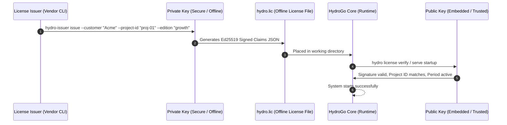

# HydroGo Licensing Architecture & Core Isolation Guide

> [!NOTE]
> HydroGo is open-source software released under the [MIT License](../LICENSE).
> This document describes the architectural design of HydroGo's Core isolation boundaries and the optional offline cryptographic licensing subsystem (Ed25519) provided within the platform for enterprise distributions.

---

## 1. Architectural Vision & Core Isolation

A central architectural principle of HydroGo is the strict separation between the engine core (**HydroGo Core**) and customer-specific business logic or presentation layers (**Client Edition**).

Generated client projects do not need to alter or fork HydroGo Core internal packages (internal engine, migration runner, core handlers). Client projects contain:

1. **Client Edition & Extension Hooks:** Custom business workflows, hooks, and plugin definitions (`extension/v1/` or `custom/`).
2. **Themes & Templates:** Filesystem-based theme templates, CSS, and component slots (`themes/`).
3. **Configuration:** Runtime configuration files and environment variable templates (`config.example.yaml`).
4. **Custom Migrations:** Project-specific database tables and schema migrations.
5. **Frontend & Headless Starters:** Web templates, Next.js/React/Astro, or SSR pages.
6. **E2E Tests:** Metadata-driven generated and custom end-to-end tests (`e2e/`).
7. **Lock File:** The `hydrogo.lock` file defining the core version, edition type, and licensing context.

---

## 2. Core Distribution Models

Three architectural options were evaluated for distributing HydroGo Core to client projects:

```mermaid
flowchart TD
    subgraph Option1 ["1. Go Module Dependency"]
        P1["Git Repository / GOPROXY"] --> B1["go build (Client CI/CD)"]
        B1 --> R1["Execution on Client Server"]
    end

    subgraph Option2 ["2. Standalone Binary"]
        P2["HydroGo Binary (hydro / hydro.exe)"] --> R2["Dynamic Theme / Config / Extension Loading"]
        R2 --> S2["Single Command Startup"]
    end

    subgraph Option3 ["3. Hosted / SaaS Runtime"]
        P3["Managed Cloud Cluster"] --> R3["Client Connects Frontend & API"]
        R3 --> S3["Zero Infrastructure Management"]
    end
```



### Comparison Matrix

| Criterion | 1. Go Module Dependency | 2. Standalone Binary | 3. Hosted / SaaS Runtime |
|---|---|---|---|
| **Core Source Code Isolation** | High (Controlled via repository access) | Very High (Only compiled machine code distributed) | Complete (Code remains on provider infrastructure) |
| **Developer Experience (DX)** | Standard Go ecosystem (`go get`, type safety) | Zero build steps, instant startup | Lowest infrastructure overhead |
| **On-Premise / Air-Gapped Operation** | Excellent | Excellent | Limited (Requires network connectivity) |
| **Customization & Plugin Flexibility** | High (Compile-time type checking) | Configuration and theme slots | API and webhook integration |
| **License Verification Support** | Compile-time & runtime offline checks | Runtime offline Ed25519 check | Centralized billing and token revocation |

### Default Model

HydroGo supports a **Hybrid Model**:
1. **Compact / Standalone Deployment:** Core runs as a precompiled `hydro` binary. The client project contains only themes, config, and `hydrogo.lock`.
2. **Enterprise Custom Edition:** For deep integrations, Core is consumed as a standard Go module.

---

## 3. The `hydrogo.lock` File

`hydrogo.lock` is the lock file that pins the Core version, generator version, and enabled features for a generated project:

```json
{
  "lock_version": 1,
  "project_id": "proj-corporate-001",
  "project_name": "Corporate Portal",
  "edition": "growth",
  "preset": "standard",
  "core": {
    "module": "github.com/ardaozyildirim/hydrogo",
    "version": "v1.2.0",
    "distribution": "binary"
  },
  "generator": {
    "version": "0.1.0",
    "generated_at": "2026-09-12T00:00:00Z"
  },
  "features": [
    "pages",
    "news",
    "commerce",
    "members"
  ],
  "licensing": {
    "required": false,
    "license_file": "hydro.lic",
    "grace_period_allowed": true
  }
}
```

---

## 4. Cryptographic Licensing Subsystem

HydroGo includes an **Ed25519-based asymmetric offline licensing engine** that operates without requiring connections to an external licensing server.

Runtime enforcement is active only when configuration specifies `license.required: true`. In standard open-source and development workflows, this is disabled by default, or bypassed using `--dev` / `HYDRO_DEV_MODE=1`.



### 4.1. Security & Key Isolation
- **Private Key:** Stored strictly within the issuer environment; never distributed to customer environments or embedded in runtime binaries.
- **Public Key:** Embedded in Core or supplied via secure configuration. Used solely for signature verification; cannot generate new licenses.

### 4.2. License Format and Claims
A `hydro.lic` document contains the following verifiable fields:
- `id`: Unique license identifier (UUID).
- `key_id`: Key slot identifier for key-rotation windows.
- `customer`: Customer or organization name.
- `project_id`: Project identifier bound to `hydrogo.lock`.
- `edition`: Licensed edition tier (`starter`, `growth`, `enterprise`, `custom`).
- `features`: Permitted feature identifiers (`pages`, `news`, `commerce`, `members`, `*`).
- `issued_at`: Issuance timestamp (RFC 3339).
- `expires_at`: Expiration timestamp (RFC 3339).
- `grace_period_days`: Additional operational grace period after expiration (default: 14 days).
- `signature`: Ed25519 signature (Base64).

### 4.3. Grace Period Mechanism
To prevent sudden operational outages upon license expiry, a **Grace Period** mechanism is supported:
- **Active State (`active`):** `now < expires_at` -> Normal operation.
- **Grace Period (`grace_period`):** `expires_at <= now <= expires_at + grace_period` -> System continues running; warnings logged in system logs and Admin Studio.
- **Expired (`expired`):** `now > expires_at + grace_period` -> Protected runtime endpoints refuse execution (`ErrLicenseExpired`).

---

## 5. Security Realities & Copy Protection Boundaries

> [!CAUTION]
> It is an engineering reality that no software running on end-user hardware can achieve 100% technical copy prevention.

The technical boundaries of the licensing subsystem are explicitly documented:
1. **Cryptographic Integrity (Tamper Evidence):** Any modification to the license file (e.g. altering expiration dates or edition tiers) invalidates the Ed25519 signature.
2. **Offline Verification:** No external network connectivity or "phone-home" telemetry is required, making it ideal for air-gapped or regulated data centers.
3. **Reverse Engineering Limits:** Any binary running in a client-controlled environment can theoretically be disassembled or patched in memory. The system is intended to provide clear auditability and contract boundaries.

---

## 6. CLI Usage Reference

License generation is separated from the runtime into the vendor-only `cmd/hydro-issuer` binary. The runtime `cmd/hydro` CLI includes verification and inspection commands:

### Generating a Keypair (`hydro-issuer`)
```bash
hydro-issuer keygen --public-out license_pub.key --private-out license_priv.key
```

### Issuing a License (`hydro-issuer`)
```bash
hydro-issuer issue \
  --customer "Acme Technologies" \
  --project-id "proj-acme-prod" \
  --key-id "vendor-2026-01" \
  --edition "growth" \
  --features "pages,news,commerce,members" \
  --expires-in "8760h" \
  --grace-days 14 \
  --private-key license_priv.key \
  --out hydro.lic
```

### Verifying a License (`hydro`)
```bash
hydro license verify \
  --license hydro.lic \
  --public-key license_pub.key \
  --project-id "proj-acme-prod" \
  --key-id "vendor-2026-01" \
  --edition "growth" \
  --feature "commerce"
```

### Inspecting License Status (`hydro`)
```bash
# Human-readable summary
hydro license status --license hydro.lic --public-key license_pub.key

# JSON output for CI/CD automation
hydro license status --license hydro.lic --public-key license_pub.key --json
```
