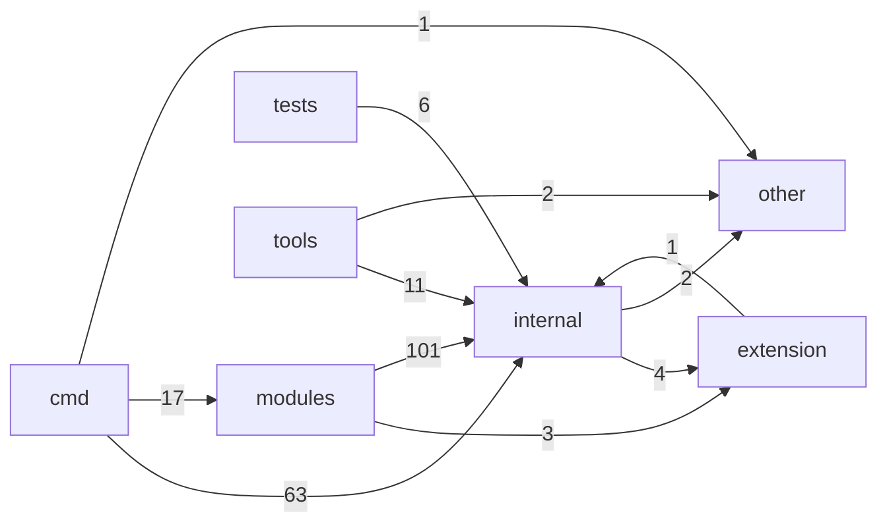

# Code map

Generated by `go run ./tools/codegraph`; do not edit. CI fails when it is stale (`-check`).
Open [codegraph.html](codegraph.html) in a browser for the interactive graph; [codegraph.json](codegraph.json) holds the same data.

Read this first when you are new to the code or an AI assistant asked to change it: it shows where things live and which direction imports may flow. Module-to-module rules are enforced by `tools/moduleguard`; see `AGENTS.md` for the rules themselves.

## Layers

| Layer | Packages | Purpose |
|---|---:|---|
| `cmd` | 1 | Binary entry points: CLI commands, server composition, HTTP routes and admin APIs. |
| `extension` | 2 | Public extension SDK. |
| `internal` | 88 | Cross-cutting capabilities: auth, database, outbox, jobs, mailer, audit, config and more. |
| `modules` | 17 | Feature modules: pages, news, members, site, seo, commerce. |
| `other` | 2 |  |
| `tests` | 3 | Contract and end-to-end tests. |
| `tools` | 13 | Repository guards and developer tooling. |

## How layers import each other

The number is how many package-to-package imports cross that line.

## Most imported packages

Changing one of these touches the most code.

| Package | Imported by | Imports |
|---|---:|---:|
| `internal/database` | 52 | 3 |
| `internal/tenant` | 42 | 0 |
| `internal/auth` | 22 | 10 |
| `internal/security` | 16 | 3 |
| `internal/guards` | 14 | 0 |
| `internal/api` | 13 | 1 |
| `internal/canonical` | 12 | 0 |
| `internal/requestmeta` | 12 | 0 |
| `internal/router` | 9 | 2 |
| `internal/contenttypes` | 8 | 7 |
| `internal/realtime` | 8 | 2 |
| `internal/collections` | 7 | 2 |
| `internal/pathguard` | 7 | 0 |
| `extension/v1` | 6 | 2 |
| `internal/audit` | 6 | 5 |

## Packages that import the most

Usually composition code: the place to look when wiring changes.

| Package | Imports | Imported by |
|---|---:|---:|
| `cmd/hydro` | 81 | 0 |
| `modules/pages/transport` | 18 | 1 |
| `modules/site/transport` | 18 | 1 |
| `modules/news` | 13 | 3 |
| `modules/news/transport` | 12 | 1 |
| `internal/auth` | 10 | 22 |
| `internal/server` | 10 | 1 |
| `modules/members/transport` | 10 | 1 |
| `internal/mcp` | 8 | 1 |
| `modules/pages/service` | 8 | 2 |

## Module dependencies

Packages under `modules/` that import another module's packages.

- `modules/pages/transport` → `modules/seo`, `modules/site`

## Package index

Each line: package, one-sentence purpose (its package comment), imported by / imports.

### cmd

- `cmd/hydro`: (no package comment) (in 0, out 81)

### extension

- `extension`: Package extension contains the experimental v0 surface available to Client Editions. (in 2, out 0)
- `extension/v1`: Package v1 contains provider-neutral contracts that generated Client Editions may import without reaching into HydroGo internals. (in 6, out 2)

### internal

- `internal/adminstudio`: Package adminstudio provides the metadata boundary used by generated admin surfaces. (in 5, out 1)
- `internal/adminstudio/sqlstore`: (no package comment) (in 2, out 3)
- `internal/adminui`: (no package comment) (in 1, out 1)
- `internal/ai`: Package ai contains the provider-neutral, opt-in content assistance boundary. (in 3, out 3)
- `internal/ai/prompts`: (no package comment) (in 3, out 0)
- `internal/analytics`: (no package comment) (in 3, out 6)
- `internal/analytics/sqlstore`: Package sqlstore provides the optional, aggregate-only analytics store. (in 1, out 4)
- `internal/api`: (no package comment) (in 13, out 1)
- `internal/audit`: (no package comment) (in 6, out 5)
- `internal/audit/sqlstore`: (no package comment) (in 3, out 4)
- `internal/auth`: (no package comment) (in 22, out 10)
- `internal/auth/sqlstore`: (no package comment) (in 3, out 3)
- `internal/backup`: Package backup contains bounded, staging-first recovery primitives. (in 1, out 3)
- `internal/blueprints`: (no package comment) (in 1, out 4)
- `internal/blueprints/instructions`: (no package comment) (in 1, out 0)
- `internal/cache`: (no package comment) (in 4, out 3)
- `internal/canonical`: (no package comment) (in 12, out 0)
- `internal/capacity`: Package capacity defines topology profiles and their bounded local budgets. (in 2, out 0)
- `internal/collections`: Package collections stores user-defined collection schemas and records in bounded, pre-migrated tables. (in 7, out 2)
- `internal/collections/sqlstore`: Package sqlstore persists dynamic collection metadata and JSON records in static, versioned tables. (in 2, out 3)
- `internal/config`: (no package comment) (in 2, out 5)
- `internal/content`: (no package comment) (in 1, out 0)
- `internal/contenttypes`: Package contenttypes turns YAML content-type definitions into the two runtime shapes HydroGo needs: a collections.Schema for storage and validation, and an a... (in 8, out 7)
- `internal/contracts/customerorders`: Package customerorders defines the narrow order projection exposed to the member account surface. (in 2, out 1)
- `internal/cron`: Package cron parses five-field cron expressions ("minute hour day month weekday") and answers whether a minute matches. (in 2, out 0)
- `internal/customcode`: Package customcode validates and prepares operator-managed site integrations. (in 2, out 0)
- `internal/database`: (no package comment) (in 52, out 3)
- `internal/database/baselinegen`: Package baselinegen builds and verifies the schema baseline (ADR 0009). (in 2, out 1)
- `internal/erasure`: Package erasure stores durable, replayable deletion intents outside the application DB. (in 1, out 2)
- `internal/eventcatalog`: Package eventcatalog defines the stable event names that may cross the HydroGo Core boundary through the durable outbox and signed webhook layer. (in 3, out 0)
- `internal/forms`: Package forms defines a bounded, provider-neutral form contract. (in 4, out 0)
- `internal/forms/sqlstore`: (no package comment) (in 2, out 3)
- `internal/geolocation`: Package geolocation resolves coarse request locations from an operator-managed offline database and explicitly trusted proxy metadata. (in 2, out 1)
- `internal/guards`: Package guards contains small boundary checks shared by infrastructure and domain adapters. (in 14, out 0)
- `internal/hooks`: Package hooks defines the small, dialect-free event hook contract shared by Core modules and Editions. (in 0, out 0)
- `internal/i18n`: Package i18n contains bounded, locale-aware presentation helpers. (in 5, out 1)
- `internal/jobs`: Package jobs contains bounded, idempotent in-process job lease primitives. (in 3, out 0)
- `internal/jobs/sqlstore`: Package sqlstore provides a durable job lease store for SQLite and PostgreSQL. (in 1, out 2)
- `internal/linkcheck`: Package linkcheck crawls one public HTTP origin and reports broken links and assets. (in 1, out 0)
- `internal/mailer`: Package mailer provides bounded outbound notification adapters. (in 5, out 2)
- `internal/mailer/sqlstore`: (no package comment) (in 1, out 3)
- `internal/mcp`: (no package comment) (in 1, out 8)
- `internal/media`: (no package comment) (in 5, out 7)
- `internal/media/sqlstore`: (no package comment) (in 1, out 4)
- `internal/modules`: (no package comment) (in 0, out 3)
- `internal/notify`: Package notify sends short operational alerts (a new order, a reconciliation drift finding) to wherever an operator actually watches -- a chat app, not email... (in 3, out 2)
- `internal/observability`: Package observability contains bounded, process-local operational signals. (in 6, out 2)
- `internal/openapi`: (no package comment) (in 2, out 1)
- `internal/ops`: Package ops contains deterministic operational alarm evaluation. (in 0, out 0)
- `internal/outbox`: (no package comment) (in 2, out 0)
- `internal/outbox/sqlstore`: (no package comment) (in 1, out 4)
- `internal/pathguard`: Package pathguard contains filesystem path checks shared by destructive and release-sensitive workflows. (in 7, out 0)
- `internal/portable`: Package portable defines the allowlisted, secret-free content export format. (in 1, out 1)
- `internal/preview`: (no package comment) (in 3, out 0)
- `internal/push`: Package push delivers bounded, opt-in notifications to registered Web Push and FCM devices. (in 3, out 4)
- `internal/push/sqlstore`: (no package comment) (in 1, out 3)
- `internal/query`: Package query defines the bounded, provider-neutral query contract used by generated transports. (in 0, out 1)
- `internal/realtime`: (no package comment) (in 8, out 2)
- `internal/release`: Package release builds deterministic release manifests and signatures. (in 1, out 2)
- `internal/requestmeta`: Package requestmeta derives request metadata at the HTTP trust boundary. (in 12, out 0)
- `internal/richtext`: Package richtext holds the server-side helpers for stored rich text: the HTML sanitizer applied on save and a plain-text projection of the Quill Delta format... (in 4, out 0)
- `internal/router`: (no package comment) (in 9, out 2)
- `internal/scaffold`: Package scaffold creates the files of a new HydroGo project: a config, the content types of a chosen preset, a .gitignore and a short README. (in 1, out 1)
- `internal/sdkdist`: (no package comment) (in 1, out 0)
- `internal/search`: Package search defines the provider-neutral search boundary. (in 1, out 5)
- `internal/security`: (no package comment) (in 16, out 3)
- `internal/security/bffpolicy`: Package bffpolicy contains the narrow request boundary a separate web BFF must apply before calling HydroGo. (in 1, out 0)
- `internal/security/bffproxy`: Package bffproxy provides a deliberately small server-side BFF adapter. (in 0, out 3)
- `internal/security/bffsession`: Package bffsession contains a bounded reference session adapter for a web BFF. (in 1, out 0)
- `internal/security/sqlstore`: (no package comment) (in 1, out 2)
- `internal/server`: (no package comment) (in 1, out 10)
- `internal/sitegen`: (no package comment) (in 0, out 5)
- `internal/storage`: Package storage contains bounded filesystem protection primitives. (in 2, out 0)
- `internal/storage/sqlite`: (no package comment) (in 2, out 0)
- `internal/storefront`: (no package comment) (in 1, out 1)
- `internal/taxonomy`: Package taxonomy contains the provider-neutral taxonomy contract. (in 0, out 1)
- `internal/telemetry`: Package telemetry contains dependency-light tracing primitives usable by low-level packages without importing HTTP/auth observability middleware. (in 1, out 0)
- `internal/tenant`: Package tenant contains the opt-in tenant-scope primitives used by shared multi-tenant adapters. (in 42, out 0)
- `internal/testgen`: Package testgen turns content-type definitions into Playwright specs that prove every admin role gets exactly the read/write access its declared permissions ... (in 1, out 1)
- `internal/testhttp`: Package testhttp contains in-memory HTTP transports for tests that do not need to exercise socket behavior. (in 0, out 0)
- `internal/testmysql`: Package testmysql creates isolated databases for opt-in MySQL integration contracts. (in 0, out 2)
- `internal/testpostgres`: Package testpostgres gives opt-in PostgreSQL contracts their own schema, so a contract can run again, and next to other contracts, on one shared database. (in 0, out 1)
- `internal/trash`: (no package comment) (in 3, out 2)
- `internal/trash/sqlstore`: (no package comment) (in 1, out 3)
- `internal/trash/transport`: (no package comment) (in 1, out 4)
- `internal/updater`: Package updater implements signed, runtime-aware self-update checks, atomic binary replacement, and rollback for HydroGo. (in 1, out 1)
- `internal/webhooks`: Package webhooks delivers signed application events to configured external systems. (in 1, out 5)
- `internal/xlsx`: Package xlsx writes bounded UTF-8 spreadsheets without external runtimes. (in 2, out 0)

### modules

- `modules/commerce`: Package commerce is the cart, checkout and order lifecycle module. (in 3, out 3)
- `modules/commerce/repository/sqlstore`: Package sqlstore is modules/commerce's persistence layer: stock reservation, carts and orders. (in 1, out 3)
- `modules/commerce/transport`: Package transport exposes modules/commerce over HTTP: a public cart and checkout API (an anonymous visitor needs no account, see identity) and protected admi... (in 1, out 6)
- `modules/members`: (no package comment) (in 3, out 4)
- `modules/members/sqlstore`: (no package comment) (in 1, out 4)
- `modules/members/transport`: (no package comment) (in 1, out 10)
- `modules/news`: (no package comment) (in 3, out 13)
- `modules/news/repository/sqlstore`: (no package comment) (in 1, out 4)
- `modules/news/transport`: (no package comment) (in 1, out 12)
- `modules/pages`: (no package comment) (in 4, out 0)
- `modules/pages/repository/sqlstore`: (no package comment) (in 1, out 4)
- `modules/pages/service`: (no package comment) (in 2, out 8)
- `modules/pages/transport`: (no package comment) (in 1, out 18)
- `modules/seo`: Package seo contains provider-neutral public discovery and social metadata. (in 2, out 0)
- `modules/site`: (no package comment) (in 4, out 7)
- `modules/site/repository/sqlstore`: (no package comment) (in 1, out 4)
- `modules/site/transport`: (no package comment) (in 1, out 18)

### other

- `content-types`: Package contenttypedata embeds the stock content type definitions so the hydro binary can scaffold new projects without the source tree. (in 1, out 0)
- `migrations`: (no package comment) (in 4, out 0)

### tests

- `tests/e2e/support/seedinvite`: Command seedinvite issues a real, SQL-backed invitation for browser tests. (in 0, out 3)
- `tests/e2e/support/seedroles`: Command seedroles creates deterministic editor/viewer accounts for the isolated Admin Studio browser test database only. (in 0, out 3)
- `tests/e2e/support/totp-code`: (no package comment) (in 0, out 0)

### tools

- `tools/actionguard`: Command actionguard rejects mutable GitHub Actions references in repository workflows. (in 0, out 0)
- `tools/baselinegen`: Command baselinegen regenerates the schema baseline under migrations/baseline (ADR 0009) from the migration chain. (in 0, out 3)
- `tools/bench`: Command bench runs automated performance and load benchmarks against HydroGo. (in 0, out 0)
- `tools/check`: Command check runs the fast local verification every change must pass: build, vet, formatting, repository guards and the test suite. (in 0, out 0)
- `tools/codegraph`: Command codegraph maps the Go packages of this repository: which layer each belongs to, what it imports and what imports it. (in 0, out 0)
- `tools/codeguard`: Command codeguard ratchets two code-shape rules for tracked Go sources: (in 0, out 0)
- `tools/devserver`: Command devserver provides a local-only live development proxy for HydroGo. (in 0, out 1)
- `tools/e2egen`: Command e2egen generates deterministic Playwright tests from explicit Admin Studio and frontend manifests. (in 0, out 0)
- `tools/factory`: (no package comment) (in 0, out 7)
- `tools/migrationguard`: (no package comment) (in 0, out 2)
- `tools/moduleguard`: Command moduleguard enforces the declared direct dependency graph between HydroGo modules. (in 0, out 0)
- `tools/openapidiff`: (no package comment) (in 0, out 0)
- `tools/sbom`: Command sbom writes a deterministic SPDX 2.3 document for the Go module graph. (in 0, out 0)

## Third-party dependencies

By import path prefix, with the number of repository packages that import them.

| Module | Packages |
|---|---:|
| `gopkg.in/yaml.v3` | 9 |
| `github.com/redis/go-redis` | 5 |
| `golang.org/x/net` | 5 |
| `github.com/go-sql-driver/mysql` | 4 |
| `golang.org/x/sync` | 3 |
| `golang.org/x/text` | 3 |
| `github.com/minio/minio-go` | 2 |
| `github.com/pquerna/otp` | 2 |
| `go.opentelemetry.io/otel` | 2 |
| `go.opentelemetry.io/otel/trace` | 2 |
| `golang.org/x/crypto` | 2 |
| `golang.org/x/image` | 2 |
| `golang.org/x/sys` | 2 |
| `github.com/SherClockHolmes/webpush-go` | 1 |
| `github.com/andybalholm/brotli` | 1 |
| `github.com/deepteams/webp` | 1 |
| `github.com/fsnotify/fsnotify` | 1 |
| `github.com/jackc/pgx` | 1 |
| `github.com/microcosm-cc/bluemonday` | 1 |
| `github.com/oschwald/maxminddb-golang` | 1 |
| `github.com/tucats/pdf-viewer` | 1 |
| `go.opentelemetry.io/otel/attribute` | 1 |
| `go.opentelemetry.io/otel/exporters` | 1 |
| `go.opentelemetry.io/otel/sdk` | 1 |
| `modernc.org/sqlite` | 1 |
