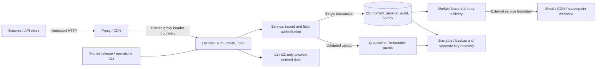

# HydroGo — Initial threat model

**Date:** 2026-09-05 · **Reviewed:** 2026-09-14 · **Status:** Design analysis; implementation evidence is tracked per validation gate.

Scope: Site Edition, per-customer isolated deployment, SQLite/PostgreSQL, admin/public HTML/JSON, local media, and subsequent object storage profile. Commerce, multi-tenant SaaS, and untrusted runtime plugins are out of scope. Binding security decisions are in [ADR-0013](../architecture/0013-identity-and-security-boundaries.md), consistency/recovery in [ADR-0011](../architecture/0011-consistency-upgrade-and-recovery.md).

## Assets and actors

Protected assets: credentials and sessions; draft/private media; publication integrity; form personal data; customer secrets; DB/backup/keys; release signatures; audit; service availability.

Actors: anonymous visitor/bot, sessioned editor, publisher/admin, operations authority, CI/release system, trusted module developer, and external service provider. Being a sessioned editor does not mean having authorization over all data. Code compiled into the binary and the host root are outside the application's sandbox boundary.

## Data flow and trust boundaries

The proxy does not magically secure every request coming to the origin. DB and object store are separate failure/transaction domains. The lifespan of public copies in the CDN/browser is independent of application transactions. CI and CLI operations are stronger than user web roles and require separate access control.

## Threat and validation matrix

Evidence is intentionally tracked in the dated validation reports and the
[open-gates register](../OPEN_GATES_AND_OPERATOR_ACTIONS.md); a row without an
explicit passing report remains **pending**. This model is not itself a release
certificate or a penetration-test result. Owners represent a responsibility
role rather than a person assignment; when a development issue is opened, a
concrete owner and outcome are added.

| ID | Concrete attack/failure | Decided control | Required evidence and gate | Owner |
|---|---|---|---|---|
| T01 | Another editor's draft is read/published by changing ID | Service record/field authorization, public projection | Role matrix on HTML/JSON/relation/worker paths; first slice | Core auth + module |
| T02 | Stolen/old session works after role revocation | Session rotate/revoke, live policy | Login fixation, role change, revoke test in two slots; first slice | Core auth |
| T03 | Reset/invite is reused, account list is discovered | Purpose/hash/expiry/atomic consume, generic response | Same token cannot be concurrently consumed twice; pilot | Core auth |
| T04 | Admin password compromised; bypasses recovery MFA | Pilot MFA, recovery audit and rate limit | TOTP replay, seed secrecy, recovery flow; pilot | Core auth + operations |
| T05 | Another site makes changes with user's browser session | CSRF, origin/proxy validation, narrow CORS | Missing/invalid token, cross origin and HTML/JSON mutation test; first slice | HTTP |
| T06 | Rich text/URL/override produces persistent XSS | Escaping, sanitizer, typed output, CSP | Malicious fixture, Quill/Templ/HTMX CSP flow; first slice | UI + security |
| T07 | Media decode bomb, path traversal, private file leak | Byte/pixel/concurrency, quarantine, visibility | Fake MIME, oversized, private origin access, crash; first slice | Media |
| T08 | Cache poisoning or draft/personal data entering shared cache | Allowlisted host/query, representation key, private bypass | Host/HX-Request/Cookie/Authorization variants; first slice, profile gate for edge | HTTP + cache |
| T09 | Webhook/remote fetch accesses internal network or metadata | Feature disabled initially; egress controls when added | Redirect/DNS/private network fixtures; before feature flag | Integration |
| T10 | Login/hash/image/form/search payload exhausts resources | Admission, pool/worker/byte/queue budgets | Soak + bounded memory/queue during failure, controlled rejection; pilot | Core + operations |
| T11 | Stale invalidation arrives late, L1 holds stale publication | Generation, fan-out, reconnect reconciliation | Two web + worker, missed event/stale refill; separate process profile | Cache |
| T12 | Crash/retry produces double external effect or loses job | Outbox, lease/token, consumer idempotency, uncertainty report | Crash post-commit, timeout post-provider accept; pilot | Jobs |
| T13 | Bad migration/rollback breaks data and old client | Compatibility matrix, per-dialect metadata | Old binary restart + rollback after new write; release | DB + release |
| T14 | Backup incomplete/leaked; restore resurrects old session/job | Encryption, manifest, separate key, restore isolation | Restore on clean target, session revocation and egress quarantine; pilot | Operations |
| T15 | Fake release or dependency update propagates to customers | Signature, trusted key, lock, license/SBOM, narrow CI secret auth | Modified artifact rejection, actual module graph audit; distribution | Release |
| T16 | Audit assumed "immutable"; local host owner deletes record | Honest boundary per profile, PG roles, file isolation | Runtime audit update rejection; separate test if external target needed; pilot | Core + operations |
| T17 | Deleted personal data returns via revision/search/restore | ADR-0014: restore-independent durable deletion intent log, checkpoint and retention; isolation on miss | Backup→delete→old backup restore; crash between intent/DB, missing/old log, export and media check; personal data domain pilot | Module + operations |
| T18 | Core update turns customer hook into authorization bypass | Trusted code, narrow SDK, final service check | Two external Client Edition policy/contract tests; SDK v1 | SDK |

## Unaccepted assumptions

- Templ alone closes all XSS paths.
- Redis or pub/sub provides data correctness.
- UUID/hash is URL access control.
- Module in the same binary is isolated from malicious code.
- Successful backup command means successful restore.
- Online migration tag is seamless on every DB.
- Local SQLite audit log is immutable against host owner.
- User's copy of deleted public content can be retrieved.

## Residual risks and follow-up

If the email provider does not offer idempotency, the delivery result remains uncertain. Full compromise of the host/release key cannot be resolved by web policy; key rotation, isolated backup, and incident response are required. Public cache propagation delay is accepted with a numerical budget. These risks are measured based on customer/topology selection; writing this document does not eliminate the risk.

Pre-pilot tasks: measuring and fixing parameter/limit values, adding threat fixtures to CI, verifying deployment secret inventory and emergency revoke/restore runbook. Corresponding rows are re-evaluated when a new endpoint, external integration, module, data class, or topology is added.

Control sources are linked within [ADR-0013](../architecture/0013-identity-and-security-boundaries.md). This model is an architectural risk analysis; it is not a penetration test result.
