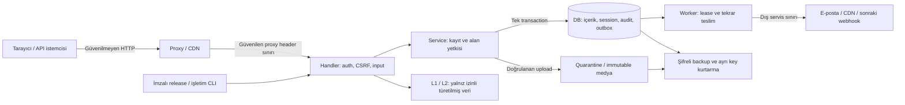

# HydroGo — İlk tehdit modeli

**Tarih:** 2026-09-05 · **Durum:** Tasarım analizi; uygulama doğrulaması bekliyor.

Kapsam: Site Edition, müşteri başına ayrı deployment, SQLite/PostgreSQL, admin/public HTML/JSON, local medya ve sonraki object storage profili. Commerce, multi-tenant SaaS ve güvenilmeyen runtime plugin kapsam dışıdır. Bağlayıcı güvenlik kararları [ADR-0013](../architecture/0013-identity-and-security-boundaries.md), tutarlılık/kurtarma [ADR-0011](../architecture/0011-consistency-upgrade-and-recovery.md) içindedir.

## Varlıklar ve aktörler

Korunan varlıklar: kimlik bilgileri ve session'lar; taslak/özel medya; yayın bütünlüğü; form kişisel verileri; müşteri sırları; DB/backup/key'ler; release imzası; audit; servis erişilebilirliği.

Aktörler: anonim ziyaretçi/bot, oturumlu editör, publisher/admin, işletim yetkilisi, CI/release sistemi, güvenilen modül geliştiricisi ve dış servis sağlayıcısı. Editörün oturumlu olması bütün veriye yetkisi olduğu anlamına gelmez. Binary'ye derlenen kod ve host root, uygulamanın sandbox sınırı dışındadır.

## Veri akışı ve güven sınırları

Proxy origin'e gelen her isteği güvenli hale getirmez. DB ve object store ayrı hata/transaction alanıdır. CDN/browser'daki public kopyaların ömrü uygulama transaction'ından bağımsızdır. CI ve CLI operasyonları kullanıcı web rollerinden daha güçlüdür ve ayrı erişim kontrolü gerektirir.

## Tehdit ve doğrulama matrisi

Tüm satırların kanıt durumu **bekliyor**. Sahipler kişi ataması değil sorumluluk rolüdür; geliştirme issue'su açıldığında somut sahip ve sonuç eklenir.

| ID | Somut saldırı/hata | Kararlaştırılan kontrol | Gerekli kanıt ve kapı | Sahip |
|---|---|---|---|---|
| T01 | Başka editörün taslağı ID değiştirerek okunur/yayımlanır | Service kayıt/alan yetkisi, public projection | HTML/JSON/ilişki/worker yollarında rol matrisi; ilk dilim | Core auth + modül |
| T02 | Çalınan/eski session rol iptalinden sonra çalışır | Session rotate/revoke, canlı policy | Login fixation, rol değişimi, iki slotta revoke testi; ilk dilim | Core auth |
| T03 | Reset/davet tekrar kullanılır, hesap listesi keşfedilir | Purpose/hash/expiry/atomic consume, genel yanıt | Aynı token eşzamanlı iki kez tüketilemez; pilot | Core auth |
| T04 | Yönetici parolası ele geçirilir; recovery MFA'yı bypass eder | Pilot MFA, recovery audit ve rate limit | TOTP replay, seed gizliliği, kurtarma akışı; pilot | Core auth + işletim |
| T05 | Başka site kullanıcının browser session'ıyla değişiklik yapar | CSRF, origin/proxy doğrulaması, dar CORS | Eksik/yanlış token, çapraz origin ve HTML/JSON mutasyon testi; ilk dilim | HTTP |
| T06 | Rich text/URL/override kalıcı XSS üretir | Escaping, sanitizer, typed output, CSP | Zararlı fixture, Quill/Templ/HTMX CSP akışı; ilk dilim | UI + güvenlik |
| T07 | Medya decode bomb, path traversal, private dosya sızıntısı | Byte/piksel/concurrency, quarantine, visibility | Sahte MIME, aşırı boyut, private origin erişimi, crash; ilk dilim | Media |
| T08 | Cache poisoning veya taslak/kişisel verinin shared cache'e girmesi | Allowlisted host/query, representation key, private bypass | Host/HX-Request/Cookie/Authorization varyantları; ilk dilim, edge için profil kapısı | HTTP + cache |
| T09 | Webhook/remote fetch iç ağa veya metadata'ya erişir | Özellik başlangıçta kapalı; eklendiğinde egress kontrolleri | Redirect/DNS/private ağ fixture'ları; özellik açılmadan | Entegrasyon |
| T10 | Login/hash/image/form/search yükü kaynakları tüketir | Admission, pool/worker/byte/queue bütçeleri | Soak + arıza sırasında bounded bellek/kuyruk, kontrollü ret; pilot | Core + işletim |
| T11 | Eski invalidation geç gelir, L1 eski yayını tutar | Generation, fan-out, reconnect uzlaştırması | İki web + worker, kayıp event/stale refill; ayrı proses profili | Cache |
| T12 | Crash/retry çift dış etki üretir veya işi kaybeder | Outbox, lease/token, tüketici idempotency, belirsizlik raporu | Commit sonrası crash, provider kabul sonrası timeout; pilot | Jobs |
| T13 | Yanlış migration/rollback veri ve eski client'ı bozar | Uyumluluk matrisi, per-dialect metadata | Eski binary restart + yeni yazımdan sonra rollback; release | DB + release |
| T14 | Backup eksik/sızdırılmış; restore eski session/job'ı canlandırır | Şifreleme, manifest, ayrı key, restore izolasyonu | Temiz hedefte restore, session iptali ve egress karantinası; pilot | İşletim |
| T15 | Sahte release veya dependency güncellemesi müşterilere yayılır | İmza, güvenilen key, lock, lisans/SBOM, dar CI secret yetkisi | Değiştirilmiş artifact reddi, gerçek module graph denetimi; dağıtım | Release |
| T16 | Audit “değişmez” sanılır; local host sahibi kayıt siler | Profile göre dürüst sınır, PG roller, dosya izolasyonu | Runtime audit update reddi; dış hedef gerekiyorsa ayrı test; pilot | Core + işletim |
| T17 | Silinen kişisel veri revision/search/restore ile geri gelir | ADR-0014: restore'dan bağımsız dayanıklı silme niyeti günlüğü, checkpoint ve retention; eksikte izolasyon | Backup→silme→eski backup restore; niyet/DB arası crash, eksik/eski günlük, export ve medya kontrolü; kişisel veri alan pilot | Modül + işletim |
| T18 | Core güncellemesi müşteri hook'unu yetki atlama yoluna çevirir | Güvenilen kod, dar SDK, son servis kontrolü | İki dış Client Edition policy/contract testleri; SDK v1 | SDK |

## Kabul edilmeyen varsayımlar

- Templ tek başına bütün XSS yollarını kapatır.
- Redis veya pub/sub veri doğruluğu sağlar.
- UUID/hash URL erişim kontrolüdür.
- Aynı binary'deki modül kötü niyetli koddan yalıtılmıştır.
- Başarılı backup komutu başarılı restore anlamına gelir.
- Online migration etiketi her DB'de kesintisizdir.
- Yerel SQLite audit kaydı host sahibine karşı değişmezdir.
- Silinen public içeriğin kullanıcıdaki kopyası geri alınabilir.

## Artık riskler ve takip

E-posta sağlayıcısı idempotency sunmuyorsa belirsiz gönderim sonucu kalır. Host/release anahtarının tam ele geçirilmesi web policy ile çözülemez; key rotasyonu, izole backup ve olay müdahalesi gerekir. Public cache yayılım gecikmesi sayısal bütçeyle kabul edilir. Bu riskler müşteri/topoloji seçimine göre ölçülür; belgenin yazılması riski kapatmaz.

Pilot öncesi yapılacaklar: parametre/limit değerlerini ölçerek sabitlemek, threat fixture'larını CI'ya eklemek, deployment secret envanteri ve acil iptal/restore runbook'unu doğrulamak. Yeni endpoint, dış entegrasyon, modül, veri sınıfı veya topoloji eklendiğinde ilgili satırlar yeniden değerlendirilir.

Kontrol kaynakları [ADR-0013](../architecture/0013-identity-and-security-boundaries.md) içinde bağlantılıdır. Bu model mimari risk analizidir; penetrasyon testi sonucu değildir.
